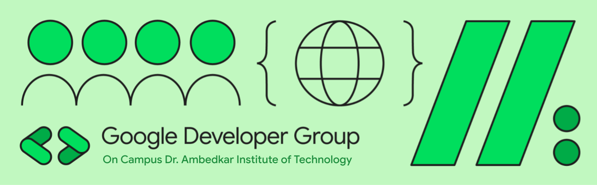

<div align="center">



# GDG on Campus – Dr. AIT

### Dr. Ambedkar Institute of Technology, Bengaluru

**Learn together. Build together. Grow together.**

A student-led developer community for learning new technologies, building real projects, and contributing to open source.

<br/>

[](https://gdg.community.dev/gdg-on-campus-dr-ambedkar-institute-of-technology-bengaluru-india/)
[](https://github.com/gdg-on-campus-drait)
[](#open-source--build-with-us)
[](#how-to-contribute)

<br/>

[About](#about-us) •
[What We Do](#what-we-do) •
[Build With Us](#open-source--build-with-us) •
[Join Us](#join-our-community) •
[Why Join](#why-join-gdg) •
[Connect](#connect-with-us) •
[Vision](#our-vision)

</div>

---

## About Us

**GDG on Campus – Dr. AIT** is a student-led developer community at Dr. Ambedkar Institute of Technology, Bengaluru, and part of the global [Google Developer Groups](https://developers.google.com/community/gdg) network. We bring together students who enjoy technology, whatever their branch, year, or experience.

We are the **biggest technical club at Dr. AIT**. Here is what we care about:

- 🔍 **Learning new technologies** through hands-on exploration
- 🛠️ **Building real-world projects** that solve real problems
- 🌍 **Open-source development** and collaboration
- 🎤 **Workshops, hackathons, and technical events**
- 🤝 **Peer-to-peer learning** and knowledge sharing
- 🔗 **Connecting** developers, innovators, and technology enthusiasts

> You don't need to be an expert to join us. Bring your curiosity and we'll learn the rest together.

---

## What We Do

<table>
  <tr>
    <td width="50%" valign="top">
      <h3>💻 Development & Engineering</h3>
      Web, mobile, and software engineering, from first prototype to production-ready apps.
    </td>
    <td width="50%" valign="top">
      <h3>🤖 AI & Machine Learning</h3>
      Exploring ML models, generative AI, and intelligent applications through practical projects.
    </td>
  </tr>
  <tr>
    <td width="50%" valign="top">
      <h3>🧩 Data Structures & Algorithms</h3>
      Problem-solving sessions, coding practice, and interview preparation, together.
    </td>
    <td width="50%" valign="top">
      <h3>☁️ Cloud & DevOps</h3>
      Cloud platforms, containers, CI/CD, and the tools for shipping software reliably.
    </td>
  </tr>
  <tr>
    <td width="50%" valign="top">
      <h3>🌐 Open Source Contributions</h3>
      Building in public, maintaining community projects, and contributing to the wider ecosystem.
    </td>
    <td width="50%" valign="top">
      <h3>⚡ Hackathons & Innovation</h3>
      Turning ideas into working solutions under time pressure, as a team.
    </td>
  </tr>
  <tr>
    <td width="50%" valign="top">
      <h3>🎓 Technical Workshops & Events</h3>
      Hands-on sessions, talks, and study jams led by peers and industry experts.
    </td>
    <td width="50%" valign="top">
      <h3>🤝 Community Building</h3>
      An inclusive space where everyone can learn, share, lead, and grow.
    </td>
  </tr>
</table>

---

## Open Source – Build With Us

<div align="center">

**Every contribution counts, and beginners are welcome.**

[](https://github.com/gdg-on-campus-drait)

</div>

Our repositories are open to developers of every experience level. Whether you're making your first pull request or you've been coding for years, there's a place for you here.

**You can contribute through:**

| Area | Examples |
| :--- | :--- |
| 💻 **Code** | New features, bug fixes, refactoring |
| 📝 **Documentation** | Guides, READMEs, tutorials, typo fixes |
| 🎨 **UI/UX & Design** | Interface improvements, accessibility, graphics |
| 🧪 **Testing** | Writing tests, reporting and reproducing bugs |
| 💡 **Ideas** | Feature suggestions, project proposals, feedback |

### How to Contribute

1. **Explore** our repositories at [github.com/gdg-on-campus-drait](https://github.com/gdg-on-campus-drait).
2. **Find an issue** to work on, or open one to suggest an improvement.
3. **Fork** the repository to your own GitHub account.
4. **Create a feature branch** for your work.
5. **Make your changes** and test them.
6. **Submit a Pull Request** with a clear description of what you changed and why.
7. **Work with the maintainers** on review feedback to refine your contribution.

<details>
<summary><b>First time contributing? Here's the workflow in commands.</b></summary>

<br/>

```bash
# 1. Fork the repository on GitHub, then clone your fork
git clone https://github.com/<your-username>/<repository-name>.git
cd <repository-name>

# 2. Create a feature branch
git checkout -b feature/your-feature-name

# 3. Make your changes, then stage and commit them
git add .
git commit -m "Add: short description of your change"

# 4. Push the branch to your fork
git push origin feature/your-feature-name

# 5. Open a Pull Request from your fork on GitHub
```

**Tips for a smooth first contribution:**

- Read the repository's README and any contributing guidelines before you start.
- Comment on an issue before starting work so others know you're on it.
- Keep pull requests small and focused on one change.
- Don't hesitate to ask questions. Everyone started somewhere.

</details>

---

## Join Our Community

<div align="center">

### Join GDG on Campus – Learn, Build, Connect!

Be part of a community that learns new technologies, builds meaningful projects, and grows together.
Sign up on our official GDG community page for event updates and to stay connected.

<br/>

[](https://gdg.community.dev/gdg-on-campus-dr-ambedkar-institute-of-technology-bengaluru-india/)

**[gdg.community.dev/gdg-on-campus-dr-ambedkar-institute-of-technology-bengaluru-india](https://gdg.community.dev/gdg-on-campus-dr-ambedkar-institute-of-technology-bengaluru-india/)**

</div>

---

## Why Join GDG?

| | |
| :---: | :--- |
| 📚 | **Learn** from peers and industry experts |
| 🛠️ | **Work on practical projects** with real impact |
| 🚀 | **Gain hands-on experience** in development |
| 🏆 | **Take part** in hackathons and technical events |
| 🌍 | **Build an open-source portfolio** that showcases your skills |
| 🤝 | **Collaborate** with developers across domains |
| 🌱 | **Develop leadership, communication, and teamwork skills** |

---

## Connect With Us

<div align="center">

[](https://github.com/gdg-on-campus-drait)
[](https://gdg.community.dev/gdg-on-campus-dr-ambedkar-institute-of-technology-bengaluru-india/)
[](https://www.instagram.com/gdg_drait/)
[](https://www.linkedin.com/groups/8102828/)

</div>

| Platform | Link |
| :--- | :--- |
| **GitHub** | [github.com/gdg-on-campus-drait](https://github.com/gdg-on-campus-drait) |
| **GDG Community** | [gdg.community.dev/gdg-on-campus-dr-ambedkar-institute-of-technology-bengaluru-india](https://gdg.community.dev/gdg-on-campus-dr-ambedkar-institute-of-technology-bengaluru-india/) |
| **Instagram** | [@gdg_drait](https://www.instagram.com/gdg_drait/) |
| **LinkedIn** | [GDG on Campus – Dr. AIT LinkedIn Group](https://www.linkedin.com/groups/8102828/) |

---

## Our Vision

<div align="center">

We are building a **collaborative developer ecosystem at Dr. AIT**:
a place where students **learn together**, **build together**, and **contribute to the global tech community**.

Every workshop, project, and pull request moves us toward a campus where knowledge is shared openly, ideas become real products, and every student can grow as a developer and a leader.

<br/>

**Your journey starts with a single step. Star a repo, open an issue, or join us at our next event.**

<br/>

[](https://gdg.community.dev/gdg-on-campus-dr-ambedkar-institute-of-technology-bengaluru-india/)
[](https://github.com/gdg-on-campus-drait)

<br/>

<sub>Made with ❤️ by the GDG on Campus – Dr. AIT community</sub>

</div>
